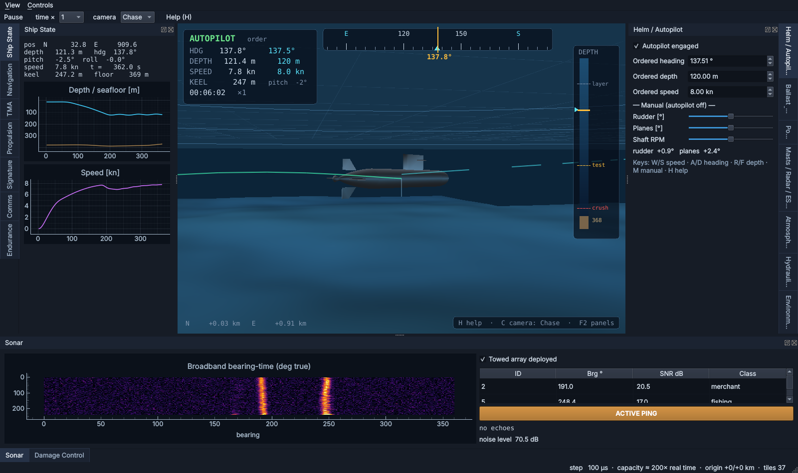
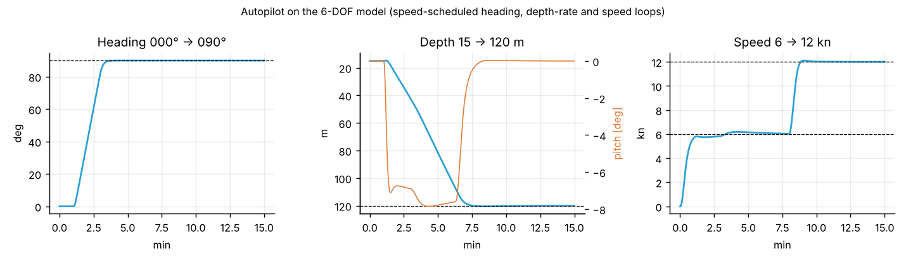
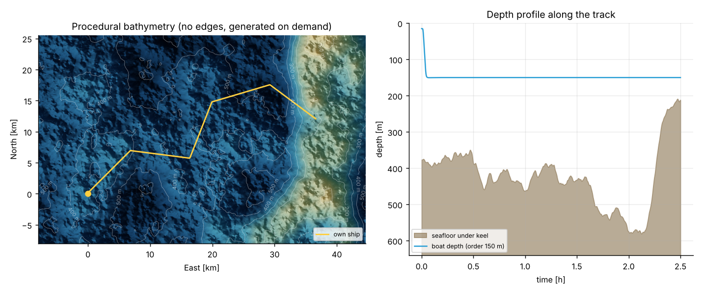
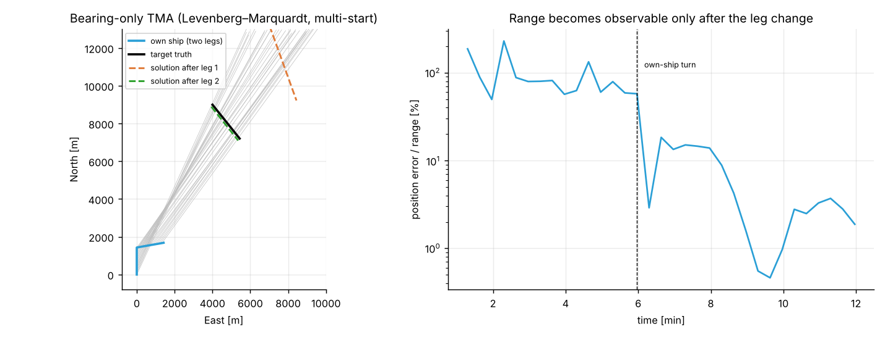
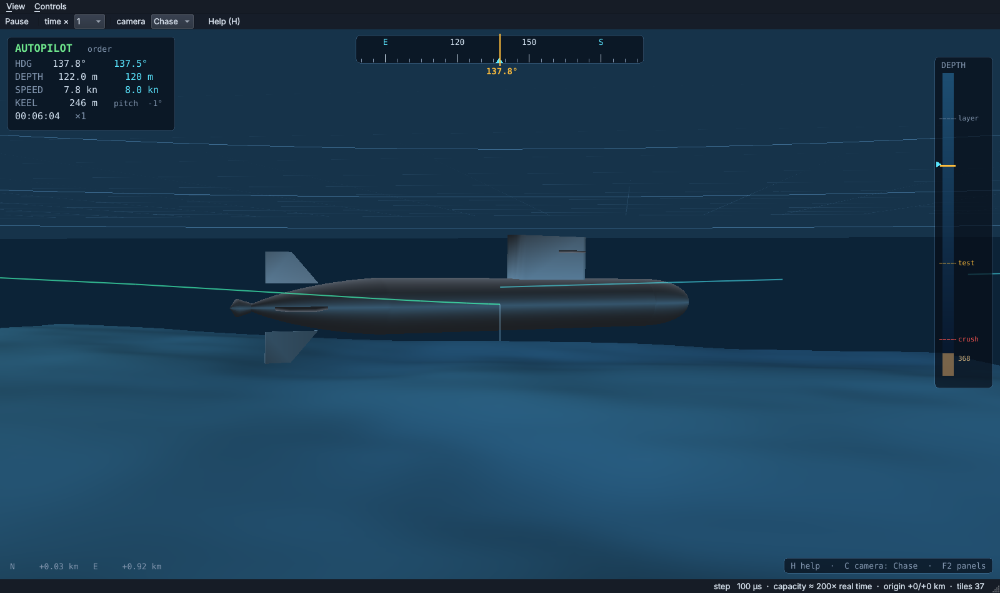
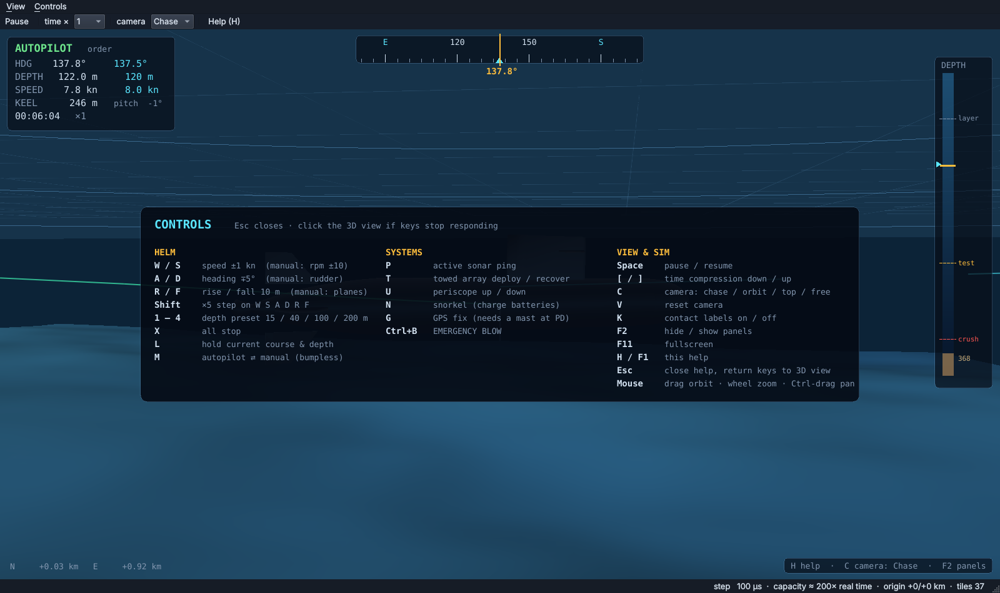

# Submarine Toolbox

Submarines are pretty awesome, and I wanted a simulator that was a little more realistic than what was easily available. The
boat is a notional ~1500 t diesel-electric sub on a full 6-DOF model, and
17 subsystems hang off it (propulsion, ballast, sonar, TMA, damage control,
atmosphere and so on). Each subsystem is a small plug-in on a shared signal
bus, so adding a new one doesn't mean touching the rest. You can drive it from
a 3D cockpit with dock panels, from the command line, or as a Python library.

None of the coefficients come from a real hull. They are plausible
magnitudes for a small SSK and nothing more.



## Install and run

You need Python 3.9 or newer.

```bash
git clone https://github.com/gaschenb/Submarine-Toolbox.git && cd Submarine-Toolbox
python -m venv .venv
# Windows: .venv\Scripts\activate     macOS/Linux: source .venv/bin/activate
pip install -r requirements.txt
pip install -e .
submarine-toolbox                  # GUI
submarine-run --depth 100 --time 600   # headless run, see CLI below
```

`python -m submarine_toolbox.main` also launches the GUI if you'd rather not
install the entry points.

## Features

1. 6-DOF rigid-body dynamics in Fossen's form, M ν̇ + C(ν)ν + D(ν)ν + g(η) = τ
   [1], integrated with RK4 at 50 Hz. Ballast, trim, flooding and the control
   surfaces all feed into it.
2. An autopilot that holds heading, depth and speed the same way from a
   hover up to 18 kn. Below ~6 kn it uses the variable ballast tank as well
   as the planes.
3. A world with no edges. The seafloor is a procedural field that is
   evaluated wherever the boat goes, terrain streams in around it, traffic
   gets recycled around own ship, and the 3D view uses a floating origin.
4. Passive and active sonar from the sonar equations [2], with a layer,
   baffles, a towed array and an own-ship signature you can actually hear
   yourself on.
5. Radar and ESM, INS drift with GPS fixes, and bearing-only target motion
   analysis [3].
6. Casualties: compartment flooding and fire, hydraulic leaks, battery load
   shedding, atmosphere control and endurance (fuel, food, water).
7. It's fast, about 90 µs per sim step, so time compression up to 100× runs
   in real time.

## Methods

### Dynamics

The hull follows Fossen's vectorial model [1] with a diagonal mass matrix
(rigid body plus added mass), Coriolis/centripetal terms built from it,
linear plus quadratic damping, and hydrostatic restoring from the weight
and the CG/CB offsets. The Coriolis terms include the Munk moment [4], which
pitches the hull nose-up when it sinks at speed and has to be fought by the
planes. Buoyancy tapers off as the hull breaks the surface. Hydrodynamic
magnitudes follow the ranges in Renilson [5]. The right-hand side is written
out in scalar form instead of as matrix products, which is where most of the
speed comes from.

Conventions are SNAME/NED [1]. Body x points forward, y to starboard and z
down, and depth is positive. Positive rudder turns to starboard, positive
planes pitch the nose up, and MBT fill 1.0 means flooded (dived) while 0.0
means blown (surfaced).

### Autopilot

1. The heading and pitch loops compute the moment needed for a fixed
   closed-loop response and divide it by the rudder or plane lift, which
   scales with u². Inverting the plant like this [6] gives the same response
   at 3 kn and at 18 kn.
2. The depth loop orders a vertical rate instead of a pitch angle. That rate
   is capped by how much pitch the planes can hold against the BG righting
   moment at the current speed. The integral uses conditional integration [7]
   so it can't wind up during big depth changes.
3. Below ~6 kn the variable ballast tank takes over whatever vertical rate
   the planes can't deliver. Feedforward from the heave drag and the plane
   force plus feedback on the rate error let the boat change depth at a hover.
4. Speed uses drag feedforward to rpm plus a PI correction.

### Acoustics

The sonar equations are from Urick [2]:

    passive:  SNR = SL − TL − NL + DI − DT
    active:   SNR = SL_ping − 2·TL + TS − NL + DI − DT

Transmission loss is spherical out to 1 km and cylindrical beyond that, plus
absorption and a 12 dB penalty when source and receiver are on opposite
sides of the layer [2]. NL power-sums sea-state ambient noise [8] with own
self-noise from the signature model, so running quiet really does buy you
range. The hull arrays are baffled ±30° astern, and the towed array removes
the baffle and adds 3 dB of DI. Measurement noise scales inversely with SNR,
and every active ping publishes a counter-detection radius.

### Sensors and TMA

1. The masts auto-house below 18 m. Surface radar sees out to the 4/3-earth
   radar horizon [9], and capable contacts can pick it up on ESM at about
   1.5× that range.
2. INS position error grows as a velocity-bias random walk, and a GPS fix at
   periscope depth snaps it back to about 5 m.
3. TMA fits a constant-velocity track to the noisy bearings with
   Levenberg–Marquardt [10] from several range hypotheses, warm-started
   between updates. Bearings-only range isn't observable until own ship
   maneuvers [3], so you need at least two legs before the range means
   anything.

### Ship systems

1. Damage: five compartments. A breach floods at Q = C_d·A·√(2g·depth) [11],
   bilge pumps lose capacity with depth (150 m head limit), and open
   watertight doors let water spill into the next compartment. Flood weight
   and its pitch moment go straight into the dynamics. Fires burn O2, dump CO2
   and damage equipment, and the hull starts failing past crush depth.
2. Hydraulics: plant pressure bleeds with surface activity and recovers on
   the pump. Low pressure slows the rudder and planes and freezes the masts.
3. Electrical: consumers publish their loads and bus voltage sags as
   V = OCV(SOC) − I·R. Non-vital loads shed below 10% SOC.
4. Atmosphere, comms (VLF wire down to 50 m, mast at periscope depth) and
   endurance (diesel at 0.22 kg/kWh, food, water) round it out.

### World

The seafloor is hashed value noise summed as fractional Brownian motion
[12, 13], with seamounts on top. It's deterministic and can be evaluated
anywhere, so there's no map edge. Grounding, keel clearance and the
terrain-ahead warning all sample it.

## Results

All of these come from `docs/figures` and are regenerated from the library.
The autopilot at 6 kn: heading 000→090, depth 15→120 m
and speed 6→12 kn.



How it does across the speed range:

| case | result |
|---|---|
| depth change at 6–18 kn | ≤ 0.5 m overshoot, no residual oscillation |
| 100 m depth change at 10–15 kn | settles to 1 m in about 2 min |
| depth change at 3 kn or hover | done on variable ballast, < 1 m overshoot |
| 90° turn at 6–18 kn | no overshoot |
| speed | 0–18 kn, settles within 0.1 kn |

A 2.5 h track over the procedural seafloor and the depth under the keel:



Two-leg bearings-only TMA on a contact at about 10 km. The range stays
unobservable on the first leg and closes to within a few percent after the
turn [3]:



## GUI

Click the 3D view so it has keyboard focus, then hit **H** for the help
overlay. The helm keys drive autopilot orders, or the raw actuators in
manual mode, and M switches between the two without a jump.

| Key | Action |
|---|---|
| W / S | speed ±1 kn (manual: shaft rpm ±10) |
| A / D | heading ∓5° (manual: rudder) |
| R / F | rise / fall 10 m (manual: planes) |
| Shift + W S A D R F | ×5 step |
| 1 – 4 | depth preset 15 / 40 / 100 / 200 m |
| X | all stop |
| L | hold current course and depth |
| M | autopilot ⇄ manual |
| P | active sonar ping |
| T | towed array deploy / recover |
| U / N | periscope / snorkel up-down (periscope depth only) |
| G | GPS fix (needs a mast at periscope depth) |
| Ctrl+B | emergency blow |
| Space | pause / resume |
| [ / ] | time compression down / up (×1 – ×100) |
| C / V | cycle camera (chase / orbit / top / free) / reset camera |
| K | contact labels on / off |
| F2 / F11 | hide panels / fullscreen |
| H or F1 / Esc | help overlay / close help and refocus the 3D view |
| Mouse | drag to orbit, wheel to zoom, Ctrl-drag to pan |

Every subsystem also has a dock panel (View menu). They're grouped into ship
control (helm, ballast, propulsion, power, state), acoustics (sonar,
signature, environment), tactical (masts, navigation, TMA, comms) and ship
systems (atmosphere, damage, hydraulics, endurance).





## CLI

`submarine-run` runs the boat headless. It sets the orders, runs the sim,
prints the final state and can dump a telemetry log.

```bash
submarine-run --depth 120 --heading 90 --speed 10 --time 600 --csv run.csv
# t=600 s  depth=120.0 m  heading=90.0°  speed=10.0 kn  pitch=+0.0°  soc=97%
```

1. `--depth`, `--heading`, `--speed` set the orders in m, degrees and kn.
2. `--start-depth` is where the boat starts (default 15 m).
3. `--time` is the sim duration in seconds, and `--every` is the log interval.
4. `--csv` writes t, position, depth, heading, pitch, speed, rudder, planes,
   rpm and battery SOC.

## Library use

Everything the GUI does goes through the signal bus, so a script can drive the
boat the same way:

```python
import numpy as np
from submarine_toolbox import Simulation
from submarine_toolbox.subsystems import build_default_boat

sim = build_default_boat(Simulation())
sim.bus["order.depth"] = 100.0
sim.bus["order.heading"] = np.radians(90)
sim.bus["order.speed"] = 4.0
sim.step(30000)                     # 600 s at dt = 0.02
print(sim.bus["state.depth"], sim.eta)
```

`sim.bus` is a flat dict with orders (`order.*`), actuator commands
(`cmd.*`) and telemetry (`state.*`, `propulsion.*`, `ballast.*`, ...).
Panels write orders, subsystems read commands and publish telemetry, and the
dynamics read mass properties from `ballast.weight/xg/zg`.

To add a subsystem:

```python
from submarine_toolbox.core.subsystem import Subsystem

class Sonar(Subsystem):
    name = "sonar"
    def update(self, dt):
        self.put("sonar.contacts", [...])
    # def tau(self): ...   # only if it exerts forces
```

Register it with `sim.add(Sonar)`. If you want a panel, add one under
`gui/panels/` and dock it in `main_window.py`.

## Layout

```
submarine_toolbox/
├── main.py                  # GUI entry point
├── cli.py                   # headless runs (submarine-run)
├── core/
│   ├── simulation.py        # fixed-timestep engine (RK4), shared bus
│   └── subsystem.py         # Subsystem base class (update + tau)
├── dynamics/
│   ├── vessel.py            # notional ~1500 t SSK parameters
│   └── rigid_body.py        # 6-DOF: M ν̇ + C ν + D ν + g(η) = τ
├── subsystems/
│   ├── propulsion.py        # shaft lag, Kt/Kq prop model, cavitation flag
│   ├── power.py             # battery SOC, hotel load, diesel/snorkel charge
│   ├── ballast.py           # MBT, variable ballast, trim, HP air, emerg. blow
│   ├── control_surfaces.py  # rate-limited rudder + stern planes
│   ├── autopilot.py         # speed-scheduled heading/depth/speed hold
│   ├── environment.py       # SVP, current, sea state, bathymetry sampling
│   ├── contacts.py          # ambient traffic, recycled around own ship
│   ├── signature.py         # own radiated SL + counter-detection radius
│   ├── sonar.py             # passive suite (baffles, towed array), active
│   ├── atmosphere.py        # O2/CO2 balance, scrubbers, O2 gen + bank
│   ├── masts.py             # mast interlocks, surface radar, ESM
│   ├── navigation.py        # INS drift model + GPS fixes at PD
│   ├── tma.py               # bearings-only TMA (Levenberg–Marquardt)
│   ├── damage.py            # compartments, flooding, fire, crush depth
│   ├── hydraulics.py        # plant pressure, leaks, actuator dependency
│   ├── comms.py             # VLF wire / SATCOM mast, broadcast schedule
│   └── endurance.py         # diesel fuel, provisions, fresh water
├── world/
│   └── bathymetry.py        # hashed value-noise fBm seafloor, unbounded
└── gui/
    ├── main_window.py       # docks, menus, keymap wiring, paced sim loop
    ├── controls.py          # keymap (single source) + command controller
    ├── hud.py               # QPainter HUD, compass, depth gauge, help
    ├── viewer3d.py          # GL: streamed terrain, floating origin, cams
    └── panels/              # ship_control / acoustics / tactical / ship_systems
docs/figures/                # README figures
```

## Citations

1. T. I. Fossen, *Handbook of Marine Craft Hydrodynamics and Motion Control*, 2nd ed. Wiley, 2021.
2. R. J. Urick, *Principles of Underwater Sound*, 3rd ed. McGraw-Hill, 1983.
3. S. C. Nardone, A. G. Lindgren and K. F. Gong, "Fundamental properties and performance of conventional bearings-only target motion analysis," *IEEE Trans. Automatic Control*, 29(9), 775–787, 1984.
4. M. M. Munk, "The aerodynamic forces on airship hulls," NACA Report 184, 1924.
5. M. Renilson, *Submarine Hydrodynamics*, 2nd ed. Springer, 2018.
6. J.-J. E. Slotine and W. Li, *Applied Nonlinear Control*. Prentice Hall, 1991.
7. K. J. Åström and T. Hägglund, *Advanced PID Control*. ISA, 2006.
8. G. M. Wenz, "Acoustic ambient noise in the ocean: spectra and sources," *J. Acoust. Soc. Am.*, 34(12), 1936–1956, 1962.
9. M. I. Skolnik, *Introduction to Radar Systems*, 3rd ed. McGraw-Hill, 2001.
10. D. W. Marquardt, "An algorithm for least-squares estimation of nonlinear parameters," *J. SIAM*, 11(2), 431–441, 1963.
11. F. M. White, *Fluid Mechanics*, 8th ed. McGraw-Hill, 2016.
12. B. B. Mandelbrot and J. W. Van Ness, "Fractional Brownian motions, fractional noises and applications," *SIAM Review*, 10(4), 422–437, 1968.
13. K. Perlin, "An image synthesizer," *Computer Graphics (SIGGRAPH '85)*, 19(3), 287–296, 1985.
